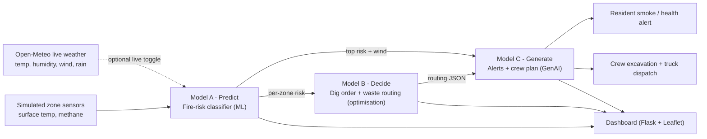

# Pipeline flowchart

Predict → Decide → Generate, feeding one live dashboard.

**Data honesty:** the zone sensor stream (surface temperature, methane) is **simulated**;
weather can be **live** (Open-Meteo). Model B is **optimisation**, not ML. See
[SOURCES.md](SOURCES.md).
